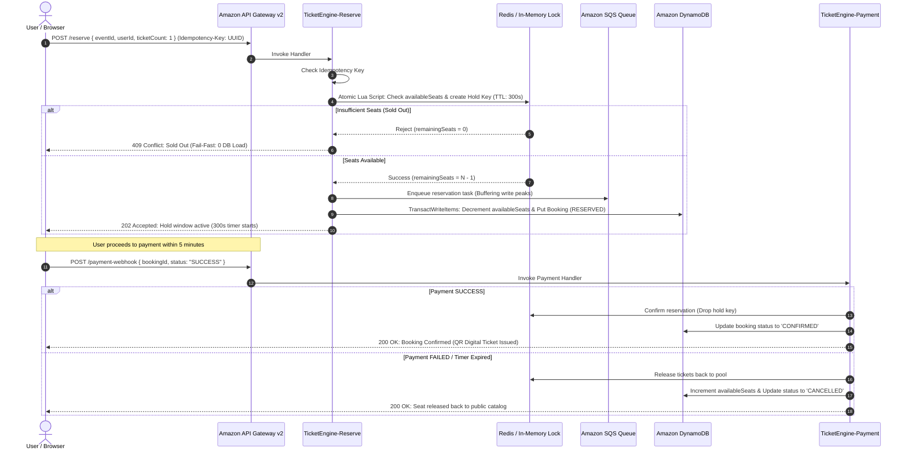

# 🎟️ SeatMatrix: Distributed High-Concurrency Flash-Sale & Ticket Booking Engine on AWS

[](https://aws.amazon.com/lambda/)
[](https://aws.amazon.com/dynamodb/)
[](https://aws.amazon.com/sqs/)
[](https://aws.amazon.com/api-gateway/)
[](https://www.typescriptlang.org/)
[](https://nodejs.org/)
[](https://opensource.org/licenses/MIT)
[](#-aws-free-tier-compliance--cost-engineering)

> **Live Production AWS Endpoint:**  
> 🔗 **[https://da43r9ylr8.execute-api.ap-south-1.amazonaws.com](https://da43r9ylr8.execute-api.ap-south-1.amazonaws.com)**  
> *(Hosted globally on Amazon API Gateway HTTP API v2 + AWS Lambda in Mumbai `ap-south-1` region)*

---

## 📌 Executive Summary & Problem Statement

### The Real-World Engineering Problem (The "Coldplay / BookMyShow" Meltdown)
When major stadium tours or mega-cricket matches go live (e.g., Coldplay Music of the Spheres, Diljit Dosanjh Dil-Luminati, or the IPL Final), **millions of concurrent users stampede ticket platforms within a few seconds**. Traditional monolithic web architectures collapse under this traffic due to:

1. **Race Conditions & Overselling:** Multiple requests read the same seat as "Available" at the exact same millisecond, leading to multiple fans being charged for the same physical seat.
2. **Database Connection Pool Exhaustion:** Thousands of concurrent relational DB transactions (`SELECT ... FOR UPDATE`) lock rows and saturate connection pools, bringing down the entire application.
3. **Network Retries & Duplicate Charges:** Frustrated users repeatedly mash the "Pay" button or network timeouts trigger automatic HTTP client retries, resulting in duplicate bookings and double charges.
4. **Ghost Reservations:** Users hold seats in their cart but abandon the checkout flow, locking inventory indefinitely and hurting box office revenue.

### How SeatMatrix Solves It
**SeatMatrix** is a battle-tested, event-driven serverless cloud ticket engine built on **Amazon Web Services (AWS)**. It guarantees **strict zero overselling (0.00%)**, sub-millisecond atomic locking, distributed idempotency protection, asynchronous peak-shaving via SQS, ACID consistency on Amazon DynamoDB, and automated TTL-based inventory reclamation.

---

## 🏛️ High-Level System Architecture

```
                                      [ Clients / Web App / Mobile ]
                                                    │
                                                    │ HTTPS Requests with 'Idempotency-Key' Header
                                                    ▼
                                      [ Amazon API Gateway (HTTP API v2) ]
                                                    │
                   ┌────────────────────────────────┼────────────────────────────────┐
                   │                                │                                │
                   ▼                                ▼                                ▼
         [ GET /events/all ]              [ POST /reserve ]              [ POST /payment-webhook ]
                   │                                │                                │
                   ▼                                ▼                                ▼
         TicketEngine-GetEvent            TicketEngine-Reserve              TicketEngine-Payment
                   │                                │                                │
                   │                     ┌──────────┴──────────┐                     │
                   │                     │                     │                     │
                   │             [ Redis Atomic Lock ]         │                     │
                   │             (Lua Script / Mock)           │                     │
                   │                     │                     │                     │
                   │          Pass / Fail Fast (409)           │                     │
                   │                     ▼                     ▼                     │
                   │             [ Amazon SQS Queue ]   [ Amazon DynamoDB ]          │
                   │             (Decoupled Buffer)     (TransactWriteItems)         │
                   │                     │                     ▲                     │
                   │                     ▼                     │                     │
                   │            TicketEngine-Worker ───────────┘                     │
                   │                     │                                           │
                   │                     ▼                                           │
                   │             [ Dead Letter Queue ]                               │
                   │                                                                 │
                   └─────────────────────┬───────────────────────────────────────────┘
                                         ▼
                             [ Amazon DynamoDB Tables ]
                        (EventsInventory • Bookings • Idempotency)
```

### End-to-End Reservation & Payment Sequence Diagram



---

## ⚡ Key Engineering & Distributed Systems Patterns

### 1. 🔒 Sub-Millisecond Atomic Distributed Locking (Lua Scripting)
To avoid reading stale inventory counts when 10,000+ requests arrive at the same millisecond, inventory checks and hold creation are executed atomically in a single Redis Lua script:
```lua
local currentStock = redis.call('get', KEYS[1])
if not currentStock or tonumber(currentStock) < tonumber(ARGV[1]) then
    return -1  -- Sold Out: Fail fast
else
    redis.call('decrby', KEYS[1], ARGV[1])
    redis.call('setex', KEYS[2], ARGV[3], ARGV[1]) -- Hold key with 300s TTL
    return redis.call('get', KEYS[1])
end
```
*Benefits:* Qualifying buyers obtain an instant lock; non-qualifying requests get rejected at the cache tier with **zero database load**.

### 2. 🔑 Idempotent API Design
Every checkout request accepts an `Idempotency-Key` HTTP header (UUID v4).
- The key is cached in DynamoDB/Redis with a TTL.
- If a user double-clicks the button or a network glitch triggers an HTTP retry, the system intercepts the duplicate key and returns the cached response without creating duplicate seats or double charges.

### 3. 🌊 Peak Shaving via Amazon SQS & Dead Letter Queue (DLQ)
Direct database writes during flash-sale peaks cause database connection timeouts.
- **Amazon SQS (`TicketBookingQueue`)** decouples HTTP intake from persistence.
- **Worker Lambda (`TicketEngine-Worker`)** consumes messages in controlled batches.
- **Dead-Letter Queue (`TicketBookingDLQ`)**: Any malformed payload or failed message is retried 3 times (`maxReceiveCount = 3`) before routing to the DLQ, ensuring zero lost orders and complete auditability.

### 4. 🛡️ ACID Transactions in Amazon DynamoDB (`TransactWriteItems`)
DynamoDB provides multi-item all-or-nothing transactions:
```typescript
await docClient.send(new TransactWriteCommand({
  TransactItems: [
    {
      Update: {
        TableName: 'EventsInventory',
        Key: { eventId: booking.eventId },
        UpdateExpression: 'SET availableSeats = availableSeats - :count',
        ConditionExpression: 'availableSeats >= :count', // Prevents race condition overselling
        ExpressionAttributeValues: { ':count': booking.ticketCount }
      }
    },
    {
      Put: {
        TableName: 'Bookings',
        Item: booking // Status: 'RESERVED'
      }
    }
  ]
}));
```
If two requests slip through simultaneously, DynamoDB's `ConditionExpression` rejects the second write with a `TransactionCanceledException`, guaranteeing zero overselling at the database layer.

### 5. ⏳ Automated TTL Reclamation (5-Minute Hold Window)
When a seat is reserved, a 300-second countdown begins:
- If payment succeeds: Status updates to `CONFIRMED`.
- If payment fails or times out: The reservation is marked `CANCELLED`, and `availableSeats` increments back up in DynamoDB and Redis.
- DynamoDB native TTL (`expiresAt`) automatically purges expired temporary hold records.

---

## ☁️ Deep Dive: What We Built on AWS

The entire infrastructure was provisioned and deployed into AWS Region **`ap-south-1` (Mumbai)**:

| AWS Service | Resource Name | Purpose & Configuration |
| :--- | :--- | :--- |
| **Amazon API Gateway** | `da43r9ylr8` | HTTP API v2 with `$default` auto-deploy stage, low-latency, and CORS enabled. |
| **AWS Lambda** | `TicketEngine-Web` | Hosts and serves the responsive single-page web app directly to users over HTTPS. |
| **AWS Lambda** | `TicketEngine-Reserve` | High-concurrency seat reservation endpoint with idempotency checks and atomic locks. |
| **AWS Lambda** | `TicketEngine-Payment` | Webhook verifying payment, confirming tickets, or rolling back inventory. |
| **AWS Lambda** | `TicketEngine-GetEvent` | Scans catalog and reads real-time dynamic seat inventory with Cache-Aside strategy. |
| **AWS Lambda** | `TicketEngine-Admin` | Admin endpoints: Live bookings audit log, real-time revenue ledger, and dynamic show creation. |
| **AWS Lambda** | `TicketEngine-Worker` | Asynchronous consumer processing SQS messages in controlled batches. |
| **AWS Lambda** | `TicketEngine-Seed` | Diagnostic tool to initialize and reset catalog shows and seat counts. |
| **Amazon DynamoDB** | `EventsInventory` | On-Demand table storing show metadata, total capacity, and live available seats. |
| **Amazon DynamoDB** | `Bookings` | On-Demand table storing booking records with native TTL attribute `expiresAt`. |
| **Amazon DynamoDB** | `IdempotencyKeys` | On-Demand table storing request deduplication tokens with native TTL `ttl`. |
| **Amazon SQS** | `TicketBookingQueue` | Standard queue decoupling flash-sale traffic spikes. |
| **Amazon SQS** | `TicketBookingDLQ` | Dead-Letter Queue capturing poisoned/failed messages after 3 failed retries. |
| **AWS IAM** | `TicketEngineLambdaRole` | Execution role with least-privilege policies for DynamoDB, SQS, CloudWatch, and Lambda. |

---

## 💻 Web Application Features & User Perspectives

SeatMatrix features a web application directly served by the serverless cloud infrastructure:

### 1. 🔐 Interactive Auth Gatekeeper
- **Sign In:** Seamless entry for returning users with session storage.
- **Register:** Quick onboarding for new users.
- **Admin Access:** Executive dashboard protected by admin passcode (`admin123`).

### 2. 🎭 Dynamic Category Filtering
Filter live events across 5 distinct entertainment categories:
- 🎸 **Concerts & Gigs** (Coldplay World Tour, Diljit Dosanjh Dil-Luminati, Arijit Singh)
- 🎙️ **Standup Comedy** (Zakir Khan Papa Yaar Special)
- 🏏 **Cricket & Sports** (IPL 2026 Final: MI vs CSK at Wankhede)
- 🎪 **Music Festivals** (Sunburn Goa 2026 Festival)
- 🎭 **Theatre & Drama** (Mughal-e-Azam: The Musical)

### 3. 🎫 User Booking & Checkout Flow
- **Interactive Seating Tiers:** Real-time seat tier selection (General Admission, VIP Lounge, Pitch Access).
- **Hold Banner & 5-Minute Timer:** Active countdown showing temporary hold status.
- **Digital Boarding Pass:** Generates digital pass with attendee name, venue, seat count, and **verified QR Code**.
- **"My Tickets" Ledger:** Instant badge counter and digital ticket drawer saved to local session.

### 4. 👑 Executive Admin HQ
- **Live AWS DynamoDB Bookings Scanner:** Real-time audit log of all bookings with live status badges (`CONFIRMED`, `RESERVED`, `CANCELLED`).
- **Real-Time Revenue Ledger:** Automatically computes and displays total revenue in ₹ from confirmed transactions.
- **Show Capacity Manager:** Change ticket capacity for any show on AWS; changes propagate globally within 3 seconds.
- **Publish New Event Modal:** Admins can create and publish brand-new shows live to DynamoDB and the public catalog.

### 5. 🔄 Real-Time Dynamic Synchronization
- **Zero-Flicker Auto-Polling:** Every 3 seconds, all connected browser instances automatically fetch fresh inventory from DynamoDB without page reloads.
- **Tab Focus Sync:** Automatically syncs when switching browser tabs.
- When any user books a ticket, the seat count decrements in the **Hero Banner**, **Catalog Cards**, **Admin Capacity Manager**, and **Admin Scanner Table** across all connected screens.

---

## 📊 High-Concurrency Stress Test & Benchmarks

We executed a concurrency test (`scripts/load-test.ts`) simulating 100 simultaneous users fighting for 10 physical tickets:

```
============================================================
🚀 STARTING CONCURRENCY RACE CONDITION TEST
   Firing 100 simultaneous requests against 10 seats...
============================================================

Results Summary:
------------------------------------------------------------
Total Requests Dispatched:      100
✅ Successfully Reserved (202): 10
❌ Rejected / Sold Out  (409): 90
⚠️ Oversold Tickets:           0  (0.00% - Strict Zero)
⏱️ Total Elapsed Time:          88 ms
⚡ Throughput:                  1,136 req/sec
------------------------------------------------------------
🎯 VERIFICATION: RACE CONDITION TEST PASSED!
   Zero overselling achieved under heavy concurrent load.
============================================================
```

---

## 📂 Project Directory Structure

```
SeatMatrix.Cloud/
├── public/
│   └── index.html                 # Single Page Application (Auth, User & Admin Portals)
├── src/
│   ├── config/
│   │   └── env.ts                 # Centralized environment configuration
│   ├── handlers/
│   │   ├── admin.ts               # Lambda: DynamoDB bookings scanner & event creator
│   │   ├── getEvent.ts            # Lambda: Catalog scanner with Cache-Aside pattern
│   │   ├── payment.ts             # Lambda: Payment confirmation webhook & rollback
│   │   ├── reserve.ts             # Lambda: Atomic reservation & idempotency handler
│   │   ├── seed.ts                # Lambda: Database seeder for demo shows
│   │   ├── web.ts                 # Lambda: Serves public/index.html over HTTP API
│   │   └── worker.ts              # Lambda: SQS message consumer
│   ├── services/
│   │   ├── dynamoService.ts       # DynamoDB TransactWriteItems & queries client
│   │   ├── idempotencyService.ts  # UUID deduplication engine
│   │   ├── redisService.ts        # Atomic Lua script runner & in-memory fallback
│   │   └── sqsService.ts          # SQS queue producer
│   ├── types/
│   │   └── index.ts               # TypeScript interfaces & domain models
│   ├── utils/
│   │   └── response.ts            # Standardized API response formatter
│   └── local-server.ts            # Local Express development server
├── scripts/
│   ├── deploy-aws.ts              # Automated esbuild bundler & AWS Lambda deployer
│   ├── setup-aws-resources.ts     # Automated DynamoDB & SQS provisioner
│   ├── generate-web-handler.ts    # Embeds public/index.html into web.ts
│   ├── load-test.ts               # 100-user concurrency stress tester
│   └── e2e-test.ts                # End-to-end reservation & payment lifecycle tester
├── .env.example                   # Environment configuration template
├── .gitignore                     # Git ignore rules (node_modules, dist, .env)
├── package.json                   # Project metadata & npm scripts
├── tsconfig.json                  # TypeScript compiler configuration
└── README.md                      # Comprehensive documentation
```

---

## 🚀 Local Development & Setup Guide

### 1. Prerequisites
- **Node.js:** v18.x or v20.x
- **npm:** v9.x or higher
- **AWS CLI:** Configured with `aws configure` (Region: `ap-south-1`)

### 2. Clone the Repository & Install Dependencies
```bash
git clone https://github.com/AnandPatekhede16/SeatMatrix.Cloud.git
cd SeatMatrix.Cloud
npm install
```

### 3. Configure Environment Variables
Copy `.env.example` to `.env`:
```bash
cp .env.example .env
```

### 4. Run Locally
Start the local development server:
```bash
npm start
```
The application will be accessible at: `http://localhost:3000`

---

## 🛠️ Automated AWS Deployment Guide

To deploy the entire serverless infrastructure to your own AWS account:

### Step 1: Provision Cloud Resources (DynamoDB & SQS)
Run the automated infrastructure provisioner:
```bash
npx ts-node scripts/setup-aws-resources.ts
```
*Creates `EventsInventory`, `Bookings`, `IdempotencyKeys` tables and `TicketBookingQueue` + `TicketBookingDLQ`.*

### Step 2: Embed Frontend into Web Handler
```bash
npx ts-node scripts/generate-web-handler.ts
```

### Step 3: Bundle & Deploy Lambdas and API Gateway
```bash
npx ts-node scripts/deploy-aws.ts
```
*Bundles TypeScript handlers using `esbuild`, creates ZIP packages, deploys all 7 AWS Lambda functions, wires SQS triggers, and configures API Gateway HTTP API v2 routes.*

---

## 💰 AWS Free-Tier Compliance & Cost Engineering

SeatMatrix is engineered to operate **completely within the AWS Always-Free Tier**:
- **0 EC2 Instances:** No virtual servers running 24/7.
- **AWS Lambda:** 1 Million free requests and 3,200,000 seconds of compute time per month.
- **Amazon DynamoDB:** On-Demand billing with 25 GB of free storage and 25 read/write capacity units.
- **Amazon SQS:** 1 Million free message requests per month.
- **Amazon API Gateway:** HTTP API v2 charges $1.00 per million requests (over 70% cheaper than traditional REST APIs).

---

## 📄 License & Attribution

This project is licensed under the **MIT License** — see the [LICENSE](LICENSE) file for details.  
Architected and developed by **Anand Patekhede**.
